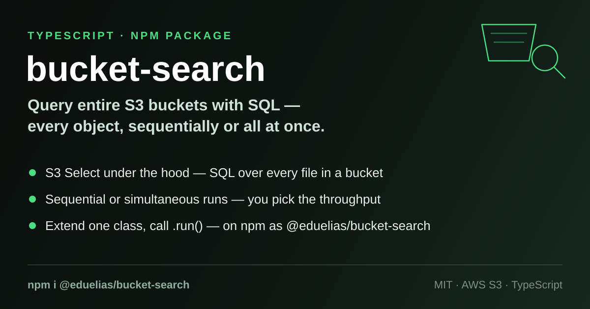

# bucket-search

<p align="center">
  
</p>

<p align="center">
  <a href="https://www.npmjs.com/package/@eduelias/bucket-search"></a>
  <a href="LICENSE"></a>
  
</p>

Run a SQL query against **every object in an S3 bucket** using
[S3 Select](https://docs.aws.amazon.com/AmazonS3/latest/userguide/selecting-content-from-objects.html).
You describe *what* to search (bucket, prefix, SQL expression) in a small
project class; `bucket-search` lists the objects (handling pagination for you)
and streams each object's matching records back through overridable hooks.
Whether the files are queried one by one or all at once is up to your `run()`
implementation.

## Features

- **SQL over S3** — one S3 Select expression, applied to every object under a
  bucket prefix.
- **Full-bucket listing** — `listObjects()` follows the `IsTruncated` /
  `Marker` pagination loop until the whole prefix is listed, with a
  `processObjectListPage` hook per page.
- **Sequential or simultaneous** — `run()` is yours: `await` each file in turn
  (see `SimpleSearchProject`) or fan out with `Promise.all`.
- **Everything is overridable** — client config, listing config, S3 Select
  input/output serialization, per-payload / stats / end-of-query hooks are all
  methods on `DefaultProject` with sensible defaults.
- **Sensible defaults** — GZIP-compressed [JSON Lines](https://jsonlines.org/)
  input and JSON output out of the box; override `getAwsQueryConfig()` for CSV
  or uncompressed data.
- **TypeScript first** — strict mode, shipped with declaration files.
- **Graceful shutdown** — `Ctrl-C` triggers the `onTerminate()` hook before
  exiting.

## Installation

```bash
npm install --save @eduelias/bucket-search
```

The only runtime dependency is `@aws-sdk/client-s3` (AWS SDK v3).

## Usage

Extend `DefaultProject`, define the three required fields (`query`, `bucket`,
`bucketPrefix`) and a `run()` method, then call `.run()`:

```ts
import { DefaultProject } from '@eduelias/bucket-search';

class ErrorLogSearch extends DefaultProject {
  public query = "SELECT * FROM S3Object s WHERE s.level = 'error'";
  public bucket = 'my-log-bucket';
  public bucketPrefix = 'logs/2024/';

  // Return true to keep consuming the record stream; the default
  // implementation returns false, which stops after the first chunk.
  processQueryPayload(): boolean {
    return true;
  }

  async run(): Promise<void> {
    const files = await this.S3Service.listObjects();
    for (const file of files) {
      const records = await this.S3Service.queryContents({
        bucket: this.getBucket(),
        bucketPrefix: this.getBucketPrefix(),
        key: file.Key as string,
        query: this.getQuery(),
      });
      if (records.length > 0) {
        console.log(`${file.Key}: ${records.length} record chunk(s) matched.`);
      }
    }
  }
}

new ErrorLogSearch().run();
```

Notes:

- `queryContents()` returns the raw `Uint8Array[]` chunks streamed back by
  S3 Select. `DefaultProject.parseS3Object<T>()` is available to decode and
  `JSON.parse` them.
- The default `getAwsQueryConfig()` targets **GZIP-compressed JSON Lines**
  objects. Querying plain JSON, CSV or uncompressed files? Override it and
  adjust `InputSerialization`.
- Missing objects (`NoSuchKey`) are logged and skipped rather than thrown.

## AWS credentials

The S3 client is created from `getClientConfig()`, which by default only sets
the region (`AWS_REGION` env var, falling back to `us-east-1`). Credentials are
resolved by the standard AWS SDK v3 provider chain — environment variables,
the shared `~/.aws/credentials` file, or an IAM role. Make sure the identity
you run under can list the bucket and run S3 Select (`s3:ListBucket`,
`s3:GetObject`) on it. Override `getClientConfig()` to pass any other
`S3ClientConfig` options.

## Examples

See [`src/examples`](src/examples): `SimpleSearchProject` is a minimal
sequential runner that lists every object under the prefix, queries each one in
turn, and logs how many records were found.

## License

MIT — see [`LICENSE`](LICENSE).

## Contributing

Contributions are welcome — see [`CONTRIBUTING.md`](CONTRIBUTING.md).
